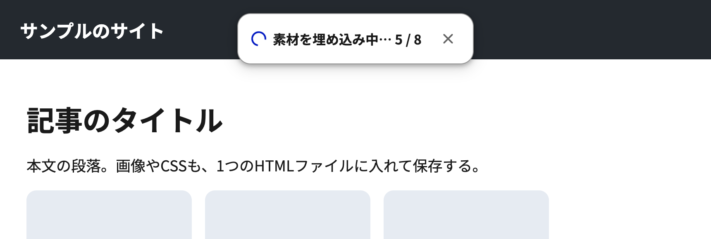

# Save Page as HTML

開いているページを、CSS・画像・フォントまで埋め込んだ1つのHTMLファイルとして保存するChrome拡張機能です。保存したファイルは、ネットにつながっていなくても、保存したときの見た目のまま開けます。ページを手元に残したい人や、見た目ごと人に渡したい人に向けています。

## 動作環境

- Google Chrome（Manifest V3に対応した版。Chrome 124以降を想定。保存したファイルの宣言的Shadow DOMを表示するため）
- macOS・Windows・Linux

## 入れ方

1. このフォルダーを手元に置く
2. Chromeで`chrome://extensions`を開き、右上の「デベロッパー モード」をオンにする
3. 「パッケージ化されていない拡張機能を読み込む」を押し、このフォルダーを選ぶ

## 使い方

ツールバーのアイコンを押す（または`Alt+Shift+H`）と、保存が始まります。ページの上に進み具合が出て、終わるとダウンロードフォルダーに`ページのタイトル-日時.html`で保存されます。

## 保存されるもの

| 対象 | 扱い |
| --- | --- |
| CSS（`<link>`、`<style>`、`@import`、JSで足したCSS） | `<style>`に入れる。中の`url()`の画像とフォントはdata: URLにする |
| 画像（``、`srcset`、`style`属性の背景、ファビコン、SVGの`<image>`、動画のポスター） | data: URLにする。`srcset`は、いま表示している1枚にする |
| `<canvas>` | その時点の絵を画像にする |
| 入力欄・チェックボックス・選択肢 | いま入っている値を残す（パスワードとファイルの欄は残さない） |
| 同じオリジンの`<iframe>` | 中身を`srcdoc`に入れる |
| Shadow DOM（閉じたものを含む） | `<template shadowrootmode>`で書き出す |
| `<script>`、`onclick`などの属性、`preload`などの`<link>` | 外す |
| リンク、動画・音声、別のオリジンの`<iframe>` | 埋め込まず、絶対URLにする |

JSを外すため、保存したファイルは「見た目の記録」です。タブの切り替えやメニューの開閉などは動きません。

## しくみ

- いまのDOM（JSで書き換わった後の状態）を、別の文書へ写し取って書き出します
- CSSは元の文字列を使います（`<link>`は取り直したファイル、`<style>`は中身）。CSSOMから書き出すと、`var()`を使った一括指定（`border: var(--w) solid var(--c)`など）が欠けることがあるためです。styled-componentsなどが`insertRule`で足したCSSと、`adoptedStyleSheets`だけは、CSSOMから書き出します
- 素材の取得は`background.js`が行います。拡張機能の側から取るため、別のドメインの画像やフォントもCORSに止められません
- 保存の前に一度下までスクロールし、スクロールしないと読み込まれない画像を読み込ませます

| ファイル | 役割 |
| --- | --- |
| `background.js` | アイコンが押されたら`save.js`を差し込む。素材を取ってくる |
| `save.js` | DOMとCSSの書き出し、素材の埋め込み、進み具合の表示、保存 |
| `icons/` | アイコン |
| `scripts/check.sh` | `manifest.json`の形式とJSの構文の検査 |

## 権限

| 権限 | 使い道 |
| --- | --- |
| `activeTab`、`scripting` | アイコンを押したタブに`save.js`を差し込む |
| `<all_urls>`（host_permissions） | 別のドメインにある画像・CSS・フォントを取る。ログインが必要な素材も取れるよう、Cookieを付けて取る |

## 注意

- `chrome://`のページやChromeウェブストアでは保存できません
- 別のオリジンの`<iframe>`（埋め込みの動画や広告など）の中身は保存されません
- 30MBを超える素材や、取れなかった素材は、埋め込まずにURLのまま残します。そのときは保存後の表示に件数が出ます
- 動画と音声は埋め込みません
- 画像やフォントが多いページは、ファイルが大きくなります。data: URLにすると、元の約1.3倍になります
- 無限スクロールのページは、保存前のスクロールで続きを読み込むことがあります。スクロールは最大10秒で止めます

## ライセンス

[MIT License](LICENSE)
